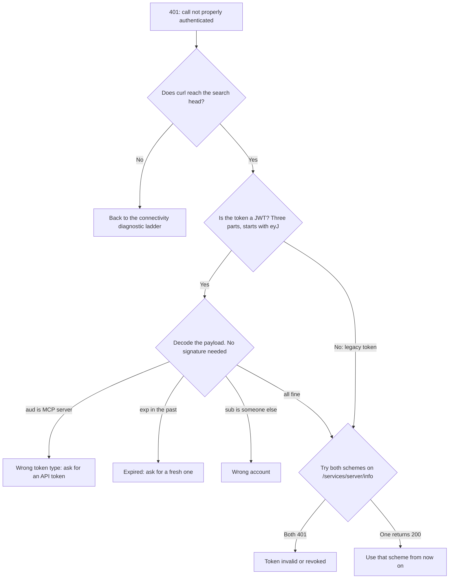

# Splunk stack access for agents: MCP or API

**Validated on:** Splunk Cloud 10.x and ITSI 4.21.x for the REST material; Splunk MCP
Server with ITSI 5.0 for the MCP side. Premium search head hostnames and the Observability
Cloud realm probe confirmed on Splunk Cloud 10.5.2605, 2026-10. Web UI fallback validated on
Splunk Enterprise 10.4.2 with ITSI 5.0.2, 2026-11. Product-specific REST work: `splunk-itsi-api-access`.

## Choose the door

| | **MCP** — Splunk MCP Server | **REST API** — port 8089 |
|---|---|---|
| For | Reading the data in the stack: searching, answering questions, investigating | Admin work: creating and changing content, building a service tree, a PoV build-out |
| Acts as | An end user. The token's roles and index permissions apply | Whatever the token's user can do — ideally an admin |
| Compliance | Full: role-based access, read-oriented tools, audited like any user | You are changing the stack. Agree scope and get a backup first |
| Token | Audience restricted to the MCP endpoint (`/services/mcp`) | A REST token. An MCP token gets 401 everywhere else |
| Network | The MCP endpoint | Management port 8089; on Splunk Cloud, your IP on the allowlist |
| Rights needed | A normal user role | Ideally admin; at least the write capabilities for what you build |
| Typical case | A production stack someone else administers; a stakeholder asking questions of their data | A PoV or lab stack you administer |

**Default to MCP whenever the task only reads.** Move to the API only when you have to change
something, and only on a stack where that has been agreed.

A third door, the **web UI on port 443**, is a fallback for admin work when 8089 cannot be
reached or a feature has no REST endpoint. It needs a username and password instead of a
token. See "Fallback: administer through the web UI" below.

| Anti-pattern | Why it hurts |
|---|---|
| An admin REST token to answer questions about the data | Bypasses the compliance MCP gives for free |
| An MCP token for build work | 401 on every non-MCP endpoint |
| Asking the Splunk admin for admin rights on production to "explore" | Wrong door; ask for an MCP user instead |

## Quick start: let an agent reach the stack

When you administer the stack yourself — a lab, a trial, a proof of value — three steps are enough:

| Step | Where | Note |
|---|---|---|
| 1. **Enable token authentication**, then create a token | `Settings → Tokens` → *Token Settings* → enable; then *New Token* | Off by default on Splunk Enterprise. Creation blocked on a SAML stack: see below |
| 2. **Splunk Cloud only: add your public IP to the allowlist** | `Settings → Server settings → IP allow list` → *Search head API access* | Find the IP with `curl -s ifconfig.me`. VPN changes it. Without it, calls time out rather than return 401 |
| 3. **Give the agent the stack URL** | The URL you use in the browser | The agent adds `:8089`, the management port. A premium search head is the exception: web URL `itsi-<stack>.splunkcloud.com`, REST host `itsi.<stack>.splunkcloud.com:8089`. Put the token in an env file at `chmod 600`, never in the chat |

If someone else administers the stack, send them the list below instead.

## Fallback: administer through the web UI (port 443)

An agent can administer a Splunk instance, or any system that only exposes a web UI, by
logging in with a headless browser and reusing that session. On Splunk it reaches the same
splunkd endpoints as 8089 through the web tier, so almost all REST work stays possible.
Clicking through screens is only needed where no endpoint exists.

**Use it when:**
- 8089 is closed and you cannot get it opened in time. Some hosted demo and training
  platforms close it on every instance. On Splunk Cloud the right fix is still the
  allowlist entry. Use this door only when that is not available.
- A feature has no usable API, for example installing an app from a local file when the
  server cannot download it, or a system with no API at all.

**Why it stays a fallback:**

| | REST on 8089 | Web UI on 443 |
|---|---|---|
| Credential | A scoped, expiring token you can revoke on its own | The account's username and password: a full interactive session, revoked only by changing the password |
| Speed | One HTTP call | A browser login first (a few seconds), then calls through the web proxy |
| Robustness | Stable API | Session expiry, CSRF tokens, login page changes. Large chunked responses can fail through the proxy (`bad character in reply size`): page with `count`/`offset` |
| SSO | Tokens work | SAML or MFA login breaks headless login. You need a local (non-SSO) account |

**What it needs:**
1. **A local account's username and password.** Store them in an env file at `chmod 600`,
   never in a script or a deliverable. Tell the user that you will log in with their
   password rather than a token.
2. **Port 443 reachable** from where the agent runs.
3. **A headless browser.** Playwright for Python plus Chromium
   (`pip install playwright requests && python -m playwright install chromium`). Put the venv in
   a scratch folder, not the deliverable workspace.
4. **The same agreement on scope and backups as REST admin work.** The access is the same,
   so the rules are too.

**How it works on Splunk:**
1. Log in through the form at `/<locale>/account/login` with Playwright. Wait until the URL
   leaves the login page, then copy the cookies into a `requests` session.
2. Call splunkd through the web proxy: `https://<host>/<locale>/splunkd/__raw/<splunkd path>`,
   for example `/en-US/splunkd/__raw/services/server/info?output_mode=json`. Send the session
   cookies plus `X-Splunk-Form-Key: <value of the splunkweb_csrf_token_<port> cookie>` and
   `X-Requested-With: XMLHttpRequest`. Writes fail without the form key. The proxy refuses
   bearer tokens: a token alone gets `303 See Other` back to the login page.
3. Body conventions are unchanged: form-encoded for `/services/*`, JSON for ITSI's
   `itoa_interface`.
4. Install or upgrade an app from a local file with `POST /<locale>/manager/appinstall/_upload`,
   multipart, with fields `splunk_form_key`, `appfile` and `force=1`. Then check the result
   with `GET /services/apps/local/<app>`. An upgrade unpacks over the old app without deleting
   files the new version no longer ships, so stale libraries can shadow new ones.
5. Restart with `POST /services/server/control/restart` through the proxy. Then poll the login
   page and log in again, because the restart ends the session.
6. Where there is no endpoint, drive the page itself with Playwright selectors, and take a
   screenshot after each step as evidence for the user.

```python
from playwright.sync_api import sync_playwright
import requests

def web_session(base, user, password, locale="en-US"):
    with sync_playwright() as p:
        browser = p.chromium.launch()
        ctx = browser.new_context(ignore_https_errors=True)
        page = ctx.new_page()
        page.goto(f"{base}/{locale}/account/login", wait_until="networkidle")
        page.fill("input[name=username]", user)
        page.fill("input[name=password]", password)
        page.keyboard.press("Enter")
        page.wait_for_url(lambda u: "account/login" not in u, timeout=60000)
        cookies = ctx.cookies()
        browser.close()
    s = requests.Session()
    for c in cookies:
        s.cookies.set(c["name"], c["value"], domain=c["domain"], path=c["path"])
    csrf = next(c["value"] for c in cookies if c["name"].startswith("splunkweb_csrf_token"))
    s.headers.update({"X-Splunk-Form-Key": csrf, "X-Requested-With": "XMLHttpRequest"})
    return s   # then s.get(f"{base}/{locale}/splunkd/__raw/services/...")
```

The same pattern works on other web-only systems: log in with the browser, then call the
JSON endpoints the web app itself uses with the session cookies and CSRF header. Read
them from the browser's network traffic.

## Prerequisites the Splunk admin must arrange

This is the email you send before you touch anything. Get all five before promising you can do API work:

1. **URL of the ITSI SH on port 8089.** On Splunk Cloud, ITSI usually runs on a premium search head whose REST host is dotted: `https://itsi.<stack>.splunkcloud.com:8089`. Its web UI is hyphenated, `https://itsi-<stack>.splunkcloud.com`, and that name fails TLS on 8089. The primary search head is `https://<stack>.splunkcloud.com:8089`.
2. **IP allowlist entry for your egress IP** (or VPN range). Splunk Cloud ships with the management port behind an allowlist; without your IP in there, every curl will time out, not 401. Verify your IP with `curl -s ifconfig.me` and send that exact value.
3. **A dedicated REST API token** — *not* an MCP token, not a session key. See the next section for why this matters. Ask the Splunk admin to create it via `Settings → Tokens → New Token` with audience like `cursor-api-access`, expiration `+90d` or `Never` per their policy. **If the stack authenticates users via SAML, confirm token issuance actually works before you commit to a date** — on Splunk Cloud 10.4+ it can be blocked outright until the SAML config is changed. See "Token creation is blocked on SAML stacks".
4. **A user account with the right capabilities** — for ITSI, see the capabilities section of `splunk-itsi-api-access`. If the token is bound to a user who doesn't have `write_itsi_service`, your CRUD calls will fail with 403 even though auth succeeds.
5. **A safe sandbox naming convention** (you bring this, not them) — see the related skill `splunk-itsi-service-tree-design` for the SANDBOX-* prefix pattern that protects production trees during exploration.

## Token types — the JWT vs MCP gotcha

There are at least three flavors of "token" floating around Splunk and they are not interchangeable. Recognize them by shape:

| Token type | Shape | Length | Use case | Works for REST? |
|---|---|---|---|---|
| **Splunk Authentication Token (JWT, modern)** | `eyJraWQi...{header}.{payload}.{sig}` — 3 base64 segments separated by `.` | ~700-800 chars | The right one. Created via `Settings → Tokens`. | **YES** |
| **MCP-bound token** (created with `aud=MCP server` or via the `mcp-remote` helper) | Looks like a Splunk JWT but the `aud` claim restricts it to the MCP endpoint | ~700-800 chars | Only works against `/services/mcp` | **NO** — 401 on every other endpoint |
| **Legacy session key / old REST token** | Single string with `==` base64 padding, often with a single `.` somewhere | ~600-700 chars | Older REST integrations | Sometimes — depends on version |

Decoding a JWT to check what it's good for (no signature verification needed):

```python
import base64, json
def b64decode(seg): 
    pad = '=' * (-len(seg) % 4)
    return base64.urlsafe_b64decode(seg + pad)
header, payload, _sig = token.split('.')
print(json.loads(b64decode(header)))   # confirms it's a JWT
print(json.loads(b64decode(payload)))  # check 'aud' claim — "Cursor API access" good, "MCP server" bad
```

The trip-wire: an admin who has only ever issued MCP tokens for Cursor will often hand you the MCP token because it's labeled "Cursor". Always read the `aud` claim before debugging connectivity.

## Token creation is blocked on SAML stacks (Splunk Cloud 10.4+)

**Observed on:** Splunk Cloud 10.4.2604.9 with a SAML IdP, Sep 2026. The same stack issued tokens without complaint on an earlier 10.x build, so treat this as a behaviour change to check for rather than a universal rule.

Creating a token in `Settings → Tokens` can fail with two errors that appear together but are independent:

```
You can only create tokens for SAML users if you enable either attribute query
requests or authentication extensions.

Role=<role> is not grantable by user <user>
```

**The SAML error is a stack configuration dependency, not something you can click past.** When users authenticate through SAML, Splunk can only re-resolve their roles at token-validation time if the SAML configuration has attribute query requests (AQR) or authentication extensions enabled. Without one of them it refuses to mint tokens for SAML-backed identities at all. Fixing it means changing the stack's authentication config — a Splunk Cloud admin or a support case.
**The role error is separate and often self-inflicted.** A token cannot carry a role you lack authority to *grant*, even one you hold yourself. The New Token dialog pre-selects every role on your account, so the request fails on the first one that trips the check. Deselect what you don't need — an ITSI REST token rarely needs the Observability roles (`o11y_*`) the dialog tends to include.

### Workaround: issue the token on a different search head

A Splunk Cloud stack has more than one search head and they do not necessarily share authentication configuration. When creation fails on the ITSI SH, try the ad-hoc search head (`https://<stack>.splunkcloud.com`, without the `itsi.` prefix). A token issued there works against `:8089` on that host and reaches **the same indexes**.

What you give up is the ITSI app namespace:

| Work | Ad-hoc SH token sufficient? |
|---|---|
| Searches, data profiling, exports (`/services/search/jobs`, `/export`) | Yes |
| Index and server introspection (`/services/data/indexes`, `server/info`) | Yes |
| Service tree, KPIs, entities, base searches, episodes (`itoa_interface`, `event_management_interface`) | **No — needs an ITSI SH token** |

Plan for this in the prerequisites. On a SAML stack a *working ITSI* token can depend on a stack-side configuration change, which is a days-not-minutes dependency. If the work is search-only — profiling an index, exporting raw events — the ad-hoc SH unblocks you the same day.

Enabling AQR or authentication extensions is an identity-side change, and past this point it stops being an ITSI problem. Splunk publishes `splunk-identity-saml-readiness-advisor` in [splunk/splunk-agent-skills](https://github.com/splunk/splunk-agent-skills) for that handoff: it diagnoses SAML configuration read-only and establishes who owns the fix. It does not touch token issuance, so the two meet at this line rather than overlap.

## The token value is shown once, and "Token ID" is not it

`Settings → Tokens` shows a 64-hex **Token ID** per token. That is the JWT's `jti` claim — not the token, and not a hash of it. The token string is displayed exactly once, at creation, and cannot be recovered afterwards.

Two consequences:

- **Capture the value at creation**, straight into `~/.cursor/<environment>.env` at `chmod 600`. If it's lost the only route is a new token, which on a SAML stack puts you back in the section above.
- **You can still identify a token you already hold.** Decode the payload and compare `jti` to the ID the admin is reading off the UI. That settles "is the token in my `.env` the one you're looking at?" before you debug anything else:

```python
import base64, json
payload = token.split('.')[1]
claims = json.loads(base64.urlsafe_b64decode(payload + '=' * (-len(payload) % 4)))
print(claims['jti'])   # compare to the Token ID shown in Settings → Tokens
print(claims['exp'])   # epoch seconds - check it is still in the future
```

Read `exp` while you are in there. An expired token fails identically to a wrong one — `401 call not properly authenticated` — so the response tells you nothing. Checking the claim is the only cheap way to tell them apart, and it is the first thing to do when access that worked last month stops working.

## Connectivity diagnostic ladder

When something fails against `:8089`, work through these in order. The HTTP code (or its absence) tells you exactly where to go next:

| Symptom | Cause | Fix |
|---|---|---|
| `curl: (28) Connection timed out` | IP not in allowlist, or the platform closes 8089 for everyone. If 443 answers on the same host and the port also times out from a second network, it is the platform | Splunk Cloud: send your egress IP to the Splunk admin. Platform-wide block: use the web UI fallback |
| `curl: (60) SSL: no alternative certificate subject name matches target host name 'itsi-<stack>.splunkcloud.com'` | Splunk Cloud: the hyphenated web-UI name used for REST. The 8089 certificate covers `*.<stack>.splunkcloud.com`, and `itsi-<stack>` is a sibling of `<stack>`, not a subdomain | Use `itsi.<stack>.splunkcloud.com:8089`. Do not add `-k` |
| `curl: (60) SSL certificate problem` | On-prem SH with a self-signed cert. Splunk Cloud certificates are publicly trusted, so there a curl 60 means the hostname is wrong | On-prem: `-k` for testing only, install the CA for production. Splunk Cloud: fix the hostname, never `-k` |
| `HTTP=303 See Other` against `https://<stack>.splunkcloud.com/...` (no port) | You hit the web UI port (443) instead of management (8089). The web tier only accepts a login session, not a token | Use `:8089` explicitly. If 8089 is unreachable, log in through the web UI fallback and call `/<locale>/splunkd/__raw/...` with the session |
| `HTTP=401 call not properly authenticated` (with `Bearer`) | Token rejected. Try `Splunk` scheme as a quick check, then check token shape | If `Splunk` also 401s, the token is invalid/expired/wrong audience. Go back to "Token types" |
| `HTTP=401` with `Authorization: Splunk <token>` but `Bearer` works | Token is JWT — `Bearer` is the right scheme. Code path that uses `Splunk` is legacy | Use `Bearer` consistently |
| `HTTP=403` after auth succeeds | Capability gap | Check `current-context` for missing capabilities — ITSI: `splunk-itsi-api-access` |
| `HTTP=500` with `bad character in reply size` | Splunk's web proxy is mangling chunked encoding through `splunkd/__raw` | Use `:8089` direct, not the `/en-US/splunkd/__raw/services/...` path |
| `HTTP=200` but `entry` is empty | You hit a `/services/` endpoint that returns wrapped JSON; ITSI's `/itoa_interface/` returns raw arrays | Check the response shape (array vs `{entry: [...]}`) |

## Proxy Egress & Local Subnet Routing

* **Local Egress Bypass (`splunk-launch.conf`):** Custom python search commands (like `earemotesearch`) run inside separate python processes. They ignore `server.conf` proxy settings and check standard OS environment variables. To bypass the proxy for local Search Head loopbacks, add the Search Head's hostname to the `no_proxy`/`NO_PROXY` environment variables in `splunk-launch.conf`.
* **Outbound Webhooks / Internal VLANs:** Webhooks pointing to local/internal IP addresses (like internal ticketing gateways on the same subnets) must also be bypassed in `splunk-launch.conf`. If not, python routes the webhook requests to the outbound egress proxy, resulting in connection timeouts (`Errno 110`).

## 401 troubleshooting flow



A legacy token may need the `Authorization: Splunk` scheme. Test both:

```bash
curl -H "Authorization: Bearer $TOKEN" ...
curl -H "Authorization: Splunk $TOKEN" ...
```

## Observability Cloud: the realm and the token

Observability Cloud has no port 8089 and no allowlist step. An agent needs two values, and
the UI shows neither where you would expect.

| Need | Trap | Do |
|---|---|---|
| The token value | Each org token shows a **Token ID** and a **Token Secret**. The ID is only an identifier | Send the secret as `X-SF-TOKEN` |
| The realm | A custom-domain UI, `<org>.observability.splunkcloud.com`, does not name it | Probe the realms below. The first 200 is the realm |

```bash
for realm in us0 us1 us2 eu0 eu1 eu2 jp0 au0 sg0; do
  code=$(curl -s -o /dev/null -w '%{http_code}' -H "X-SF-TOKEN: $SFX_TOKEN" \
    "https://api.${realm}.signalfx.com/v2/organization")
  [ "$code" = 200 ] && { echo "realm: $realm"; break; }
done
```

Confirm that the `id` in the response equals the Org ID shown in the UI before trusting the
result. Extend the list if Splunk adds a realm.

## Related skills

- `splunk-itsi-api-access` — ITSI capabilities, endpoints, payloads and a shell helper once you are connected

## Related external skills

- **`splunk-mcp-server-setup`** (chambear2809 `splunk-cisco-skills`) installs and configures the Splunk MCP Server app, issues MCP tokens and renders the client bridge. Use it once this skill has chosen MCP.
- **`splunk-cloud-acs-admin-setup`** (chambear2809 `splunk-cisco-skills`) and **`splunk-cloud-admin-copilot`** (Splunk `splunk-agent-skills`) change Splunk Cloud IP allowlists through the admin API (ACS) instead of the UI, with preflight and rollback.
